
Figures and sheet details are built by `make figures` in ../aguamapa; copy
out/figuras/ into assets/img/figuras_agua/ and the full sheets (PDF only) into
assets/downloads/. Two details and the thumbnails are re-rendered from the
PDFs instead, because the ones make writes are too small for the column:
  detalle_cuenca_cucao.png  pdftoppm -r 250, sheet 1, the Cucao plot only,
                            resized to 1400 px wide, PNG8 64 colours
  detalle_obras.png         pdftoppm -r 300, sheet 2, Llicaldad Montaña to
                            Nercón, resized to 1200 px wide, PNG8 64 colours,
                            with the stray Cuyul labels painted out
  lamina*_mini.jpg          pdftoppm -jpeg quality 82, 700 px wide
Every number in the text is printed on one of the two sheets, so if a number
changes, rebuild and reread.


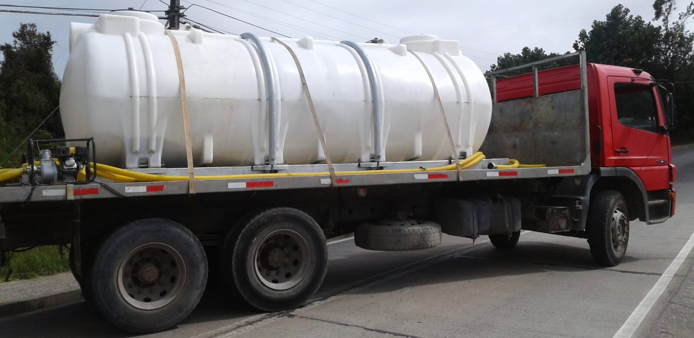

Esa es la isla entera en una imagen: 1.775 km² de ladera haciendo agua para
las captaciones de los comités, y un camión aljibe saliendo a llenar los
estanques de los vecinos.

---

## Me quedé pegada en la cartografía

Esto empezó con el [mapa de la Minga de Reparación](https://www.instagram.com/la.ecochilota/reel/DfF7HV2xJHH/). Haciendo las capas me
quedé pegada en las aguas interiores, en esa pregunta de manual —*¿conoces el
ciclo del agua en Chiloé?*— y en darme cuenta de que yo, que estaba dibujando
el mapa, poco lo entendía. Sabía nombrar ríos, y más o menos para dónde corría
cada uno. Lo que no entendía era el entramado: cómo se conectan entre sí.

Mi ejemplo es el Tarahuín. Estuve parada en su lecho, justo donde se convierte
en lago, y como el mar interior queda ahí al lado asumí que caía para allá.
Corre para el otro lado: es contribuyente de Cucao y termina en el Pacífico.
Tampoco cachaba que está más arriba que el Tepuhueico, 66 metros contra 25;
con todas las subidas que tiene el camino, el Tepuhueico se siente más alto de
lo que es. Y menos todavía sabía de dónde sale el agua que me llega a la llave.

Así que me puse a tirar números y diagramas.

## Primero salieron las cuencas

Lo primero que apareció fueron las cuencas, que son también los corredores
biológicos de la isla. Un río con su bosque de ribera es un camino continuo
entre la cordillera y el mar: por ahí se mueve el huillín, por ahí suben y
bajan los peces que pasan parte de su vida en el estuario, y por ahí viajan
las semillas y el sedimento del bosque hasta la costa. Mientras ese hilo no se
corta, lo que vive arriba y lo que vive abajo siguen siendo un solo
territorio. Dibujar una cuenca entera, de la cumbre a la desembocadura, es
dibujar ese camino.

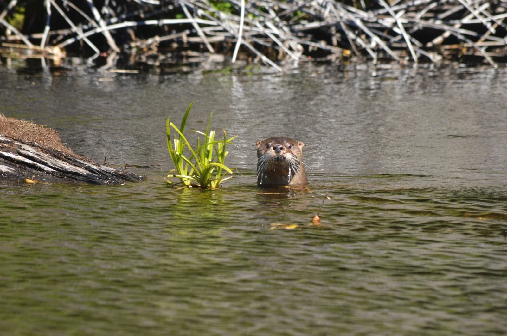
<small><em>Foto: <a href="https://www.instagram.com/carlawillin/">Carla Willin</a></em></small>
{: style="text-align: center"}

No voy a afirmar que estén prístinas; más abajo se ve que no. Pero en ellas
quedan los lugares que todavía lo son, y esos lugares valen algo que no se
mide en litros. Son alimento del alma para quienes vamos a verlos, seamos
chilotes arrancándonos el fin de semana a un trekking o a remar en kayak, o
turistas que cruzan el globo para mirar la Patagonia.

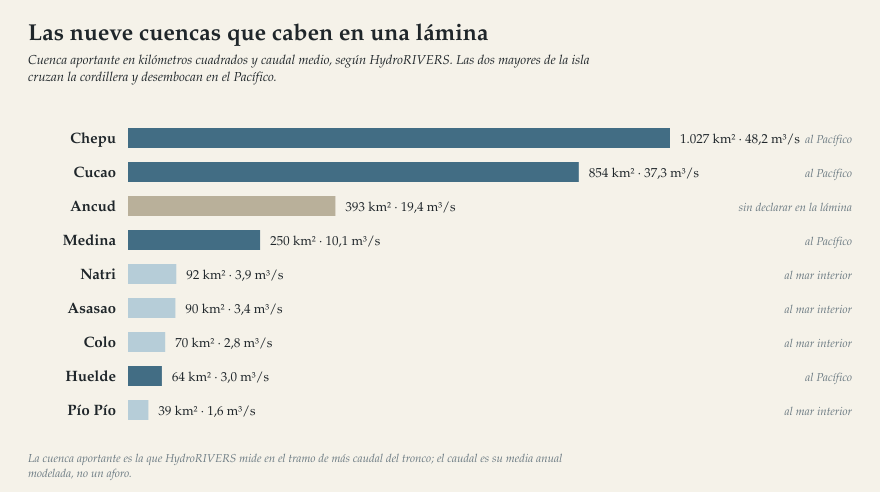

Y ahí vino la sorpresa. **Las dos cuencas más grandes de Chiloé —Chepu con
1.027 km² y Cucao con 854— no van al mar interior: cruzan la cordillera y
desembocan en el Pacífico.** Entre las dos juntan más agua que todo el resto
de lo que alcancé a dibujar. Con la cordillera del Piuchén ahí parada, una
pensaría exactamente lo contrario.

Eso es la **lámina 1**: cada cuenca en perfil, el mar a la izquierda, los ríos
como rampas y los lagos como mesetas a su cota real.

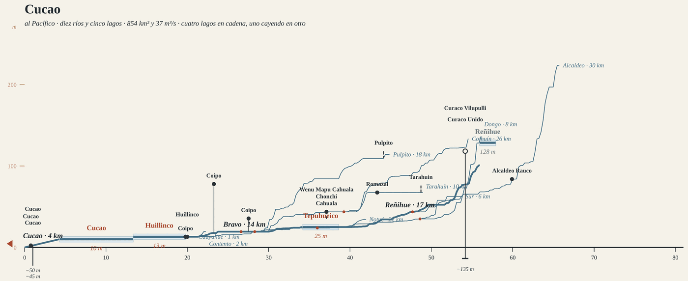

Cucao es la cadena de lagos más larga que dibujé: Cucao, Huillinco,
Tepuhueico, Reñihue, uno tras otro bajando hasta el Pacífico. La otra es la
del Medina, que nace en el lago Chaiguata, cae al Chaiguaco y de ahí corre 44
km hasta el mar. También al Pacífico, aunque yo la tenía anotada saliendo al
mar interior.

## Pero ahí no estaba el agua que tomamos

Terminé la lámina 1 contenta y con una incomodidad. En todo ese dibujo
precioso de ríos y lagos **no estaba reflejada el agua de consumo humano**.
Las captaciones aparecían como puntitos colgados de un río, y nada más.

De ahí salió la **lámina 2**, son las 296 captaciones de agua de los comités de Chiloé, sacadas del catastro
de derechos de la DGA. Y lo primero que aparece es que no todas se pueden
dibujar igual, porque no todas se pueden *medir* igual:

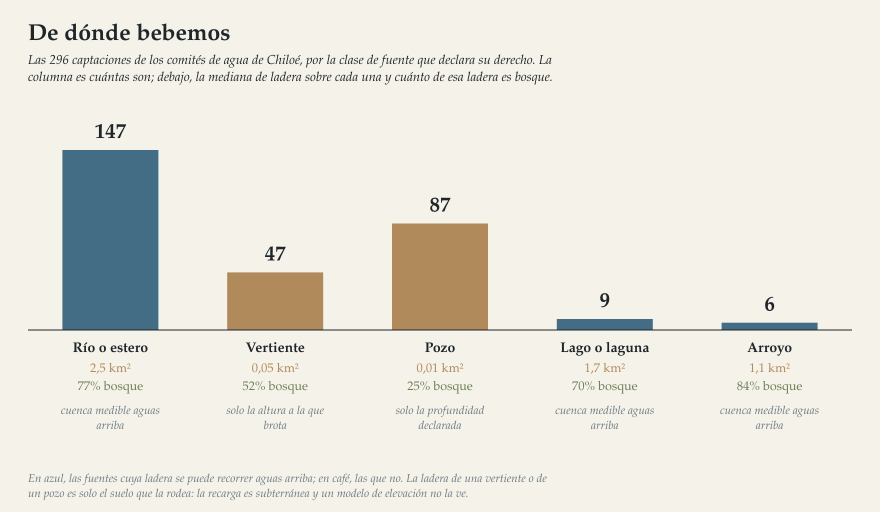

A una captación de río le puedo recorrer la ladera aguas arriba y decir
exactamente de qué tierra viene su agua. A una vertiente no: su recarga es
subterránea y ningún modelo de elevación la ve. A un pozo tampoco; de los 87
pozos, solo 38 declaran su profundidad, y la mediana es de 80 metros.

Así que cada clase está dibujada según lo que honestamente deja decir: la
cuenca para los cauces, la altura a la que brota para las vertientes, la
profundidad declarada para los pozos. Lo demás queda en blanco a propósito.

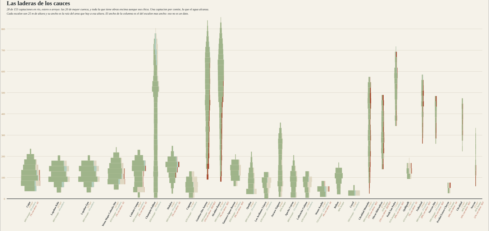

Cada columna es un comité, y cada escalón son 25 metros de altura: su ancho es
la raíz del área que hay a esa altura. Son siluetas de ladera.

## El agua la hace el bosque

Y entonces aparece el número que no me saco de la cabeza.

**De los 1.775 km² de ladera que alimentan las 296 captaciones, 1.452 km² son
bosque. El 82 %.**

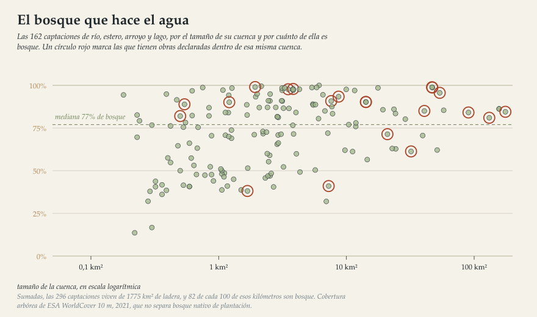

No es una metáfora ni una consigna: es la cobertura medida, punto por punto,
sobre la tierra que drena a la llave de cada casa. El agua de Chiloé no viene
de un embalse ni de un acuífero profundo y generoso. Viene de cuencas chicas
—la mediana son 2,5 km²— cubiertas de bosque, que hacen de esponja y de
filtro. Sáquenle el bosque y no queda sistema.

Y hay otra esponja que el satélite no ve: la turbera. La saqué del Inventario
Nacional de Humedales del Ministerio del Medio Ambiente, y en la lámina va con
puntitos, en el borde del bosque, porque muchas veces está debajo de él. **De
esa misma ladera, 72 km² son turbera.** El satélite la veía casi toda como
bosque o como pasto.

Por eso la lámina 2 es, al final, un dibujo de fragilidad.

## Y arriba hay obras

Lo último que hice fue cruzar esas laderas con la cartografía de los proyectos
denunciados por la comunidad: los casos que levantaron AMIPA en su
*Mapa-cartilla 1: Conflictos por las Aguas* y Chiloé Libre de Saqueo
Energético en su mapa de infraestructura.

No usé el puntito que publica el SEIA, que es un punto por proyecto y no dice
nada de una línea de 40 kilómetros. Fui a buscar los archivos que **el propio
titular adjuntó a su expediente**: los KMZ y shapefiles de torres, caminos,
servidumbres, plataformas. Y los puse sobre el mapa de escurrimiento.

**Diecisiete comités tienen obras declaradas sobre la tierra que drena a su
captación.**

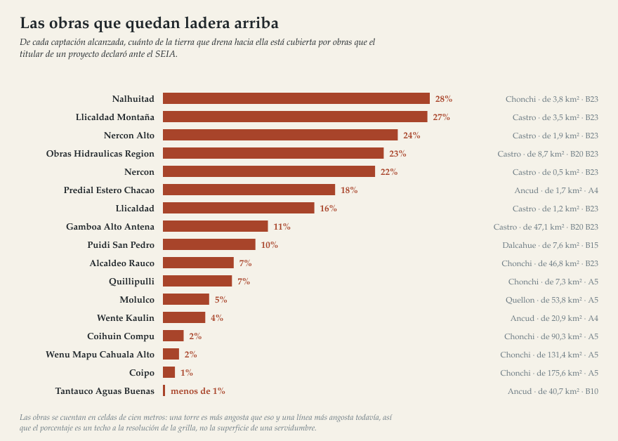

En la lámina eso es la franja roja que le come el escalón a la silueta:

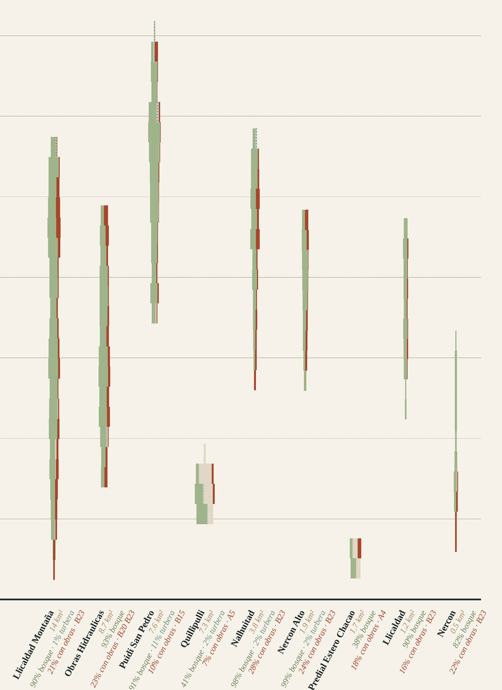

Nalhuitad, en Chonchi, tiene obras sobre el 28 % de su cuenca. Nercón Alto
sobre el 24 %. Obras Hidráulicas sobre el 23 %. Las tres tienen encima la
nueva línea de 2×220 kV Gamboa–Chonchi, expedientes 2161109256 y 2160273001,
todavía en calificación mientras escribo esto.

Cada franja roja lleva la sigla de su caso, y abajo en la misma lámina está la
lista: qué proyecto es, en qué comuna, cómo está y **con qué número de
expediente se lee completo en seia.sea.gob.cl**. Eso era innegociable para mí:
un machón rojo sobre tu APR no sirve de nada si quien está parado frente a la
lámina no puede averiguar de qué se trata.

Esa lista ahora dice también cuánta turbera hay en las celdas que tocan las
obras de cada proyecto. Las cifras más grandes son de dos parques eólicos:
13,1 km² en las de Altos de Tablaruca, entre Quellón y Chonchi, cuyo titular
desistió del estudio, y 3,2 km² en las de la ampliación de San Pedro, en
Dalcahue, que está aprobada.

Un aviso honesto sobre esos números: las obras las cuento en celdas de cien
metros. Una torre es mucho más angosta que eso y un conductor más angosto
todavía. El porcentaje y la turbera son un **techo** a la resolución de la
grilla, no la superficie de una servidumbre.

---

## Las láminas, para llevar

Las dos están para descargar acá:

| [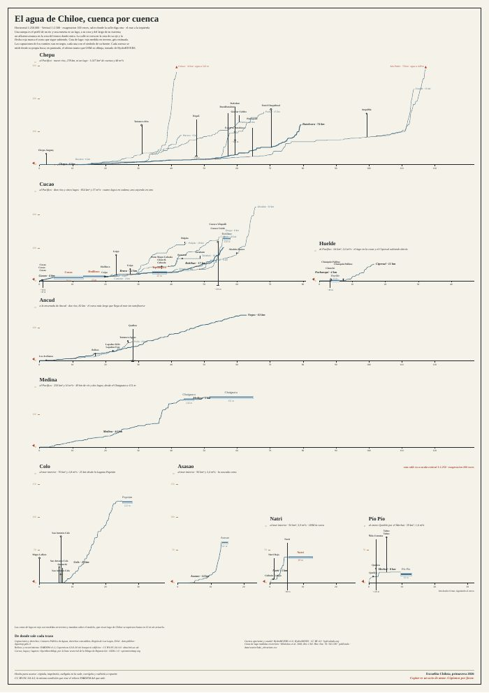](/assets/downloads/lamina1_cuencas.pdf) | [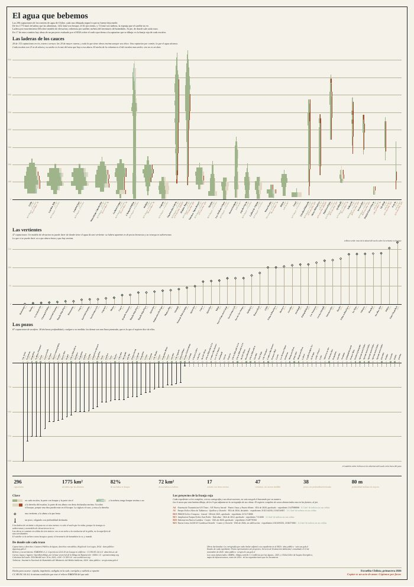](/assets/downloads/lamina2_captaciones.pdf) |

Son PDF en tamaño A1. Si tienes acceso a un plotter, imprímelas y **mándanos fotitos**, que
nos haría muy felices verlas colgadas en una sede. Si no tienes plotter: mucha
paciencia, lo siento. Me enamoré del formato y no me arrepiento. Mientras
tanto, el PDF aguanta todo el zoom que quieras en el teléfono.

Copiar es un acto de amor. Cópianos por favor: las láminas están bajo
**CC BY-NC-SA 4.0**, la misma condición que trae el modelo de relieve del que
salen. Cópialas, imprímelas, corrígelas y vuelve a repartirlas.

## Lo que les falta, y en qué me pueden ayudar

Estas láminas están incompletas y prefiero decirlo yo:

- OpenStreetMap corta 43 de los 96 cursos nombrados antes de que lleguen al
  mar. En la lámina, el tramo que falta del Natri y del Mechai va punteado,
  sacado de HydroRIVERS, que es un modelo y no un mapa. Eso se arregla
  mapeando, y se puede arreglar entre varios.
- De 48 lagos, solo 5 tienen cota medida en terreno. El resto es un modelo que
  se equivoca hasta en 13 metros y no avisa.
- La cobertura satelital no separa bosque nativo de plantación.

La pieza que más me faltaba eran las turberas y los humedales, que son la
esponja real de la isla y son justo lo que ni el modelo de elevación ni el
satélite alcanzan a ver. Una parte ya apareció: el **Inventario Nacional de
Humedales** del MMA, que antes me devolvía el listado vacío, lo entrega sin
credencial el Geoportal Humedales del ministerio. Es la turbera con puntitos
de la lámina 2.

El inventario dice dónde está la turbera y si ya la explotaron, pero no qué
tan profunda es ni cuánta agua guarda. Eso lo dirían dos datos que busqué y no
conseguí. **Si alguien los tiene o sabe cómo pedirlos, escríbenos.**

1. El **catastro de turberas de *Sphagnum*** de ODEPA/Geosoluciones para
   Llanquihue–Chiloé–Palena. El informe dice que generó capas SIG; no están
   publicadas.
2. El **catastro geológico de turba** de SERNAGEOMIN con el GORE Los Lagos,
   de 2007.

## Cómo están hechas

El relieve es FABDEM v1-2 (CC BY-NC-SA 4.0); el escurrimiento lo calculé yo
con relleno de depresiones y ruteo D8 sobre una grilla de cien metros. La
cobertura es ESA WorldCover 10 m 2021 (CC BY 4.0), y la turbera, el Inventario
Nacional de Humedales del Ministerio del Medio Ambiente. Los cursos y lagos
vienen de OpenStreetMap por la base de la Minga (ODbL), y el tramo final que
OSM no dibuja, de HydroRIVERS (CC BY 4.0). Las captaciones son el
Catastro Público de Aguas de la DGA. Las obras son la cartografía de los
expedientes del SEIA. Cada lámina lleva su propia lista de fuentes impresa al
pie, con licencia y todo.

Si encuentras un error —un nombre mal escrito, un río que no va para allá, una
cota que no es— dímelo. Es exactamente para eso que están hechas así.

<small><em>Actualizado el 18 de noviembre de 2026: la lámina 2 ahora dibuja la
turbera del Inventario Nacional de Humedales, y la lámina 1 corrige tres
cauces que OpenStreetMap dejaba cortados: el Medina sale al Pacífico, el Pío
Pío sale al estero Queilén por el Mechai y el Natri llega al mar interior.</em></small>
